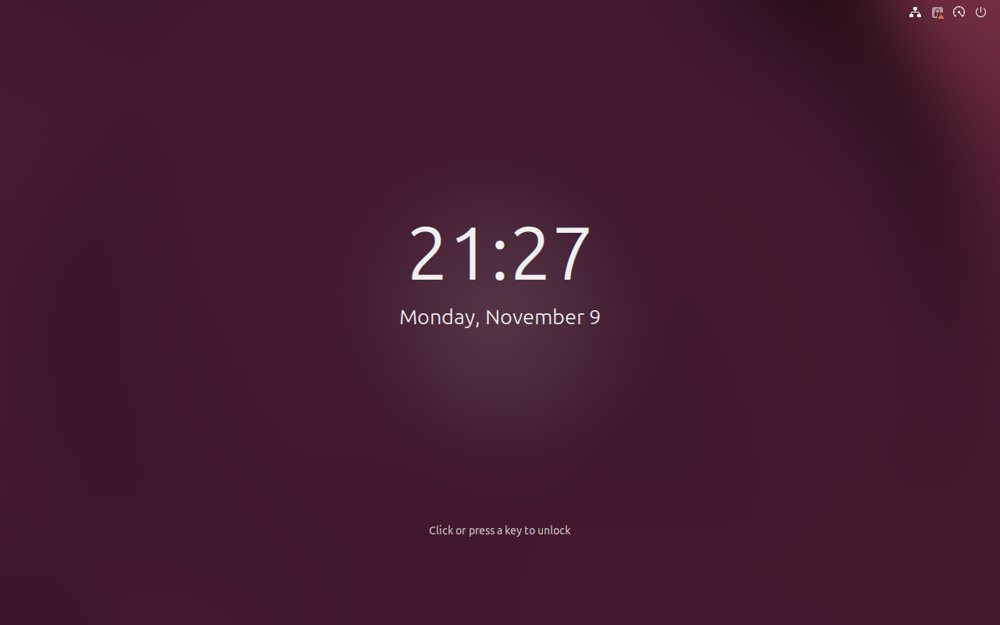
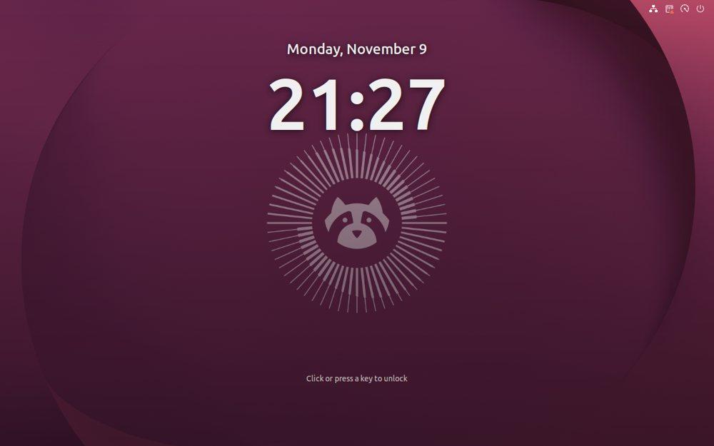
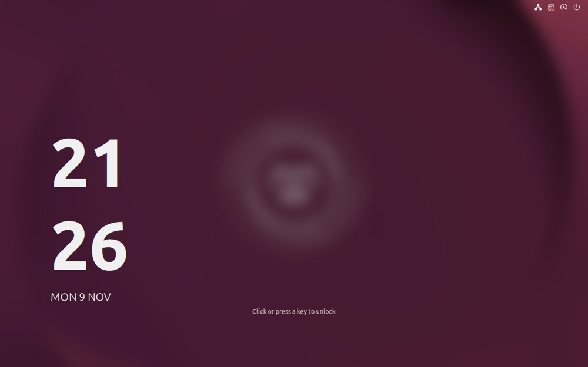
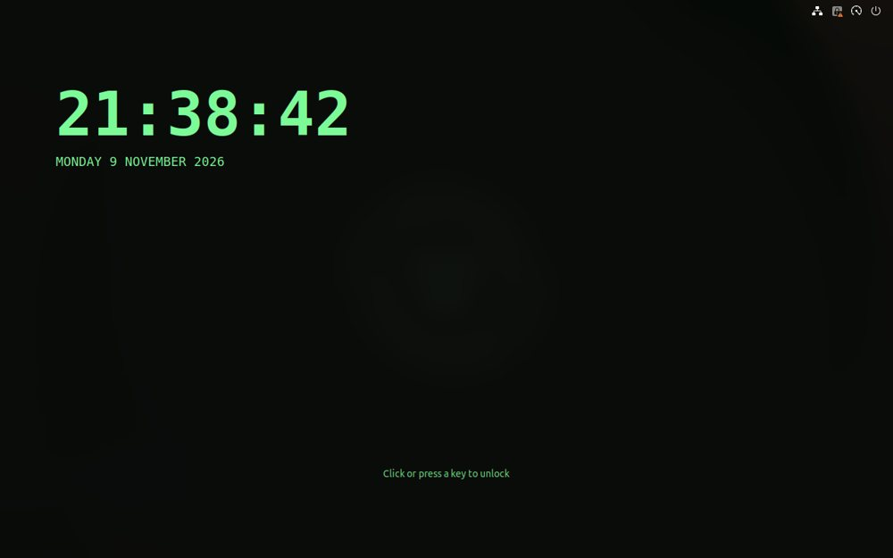
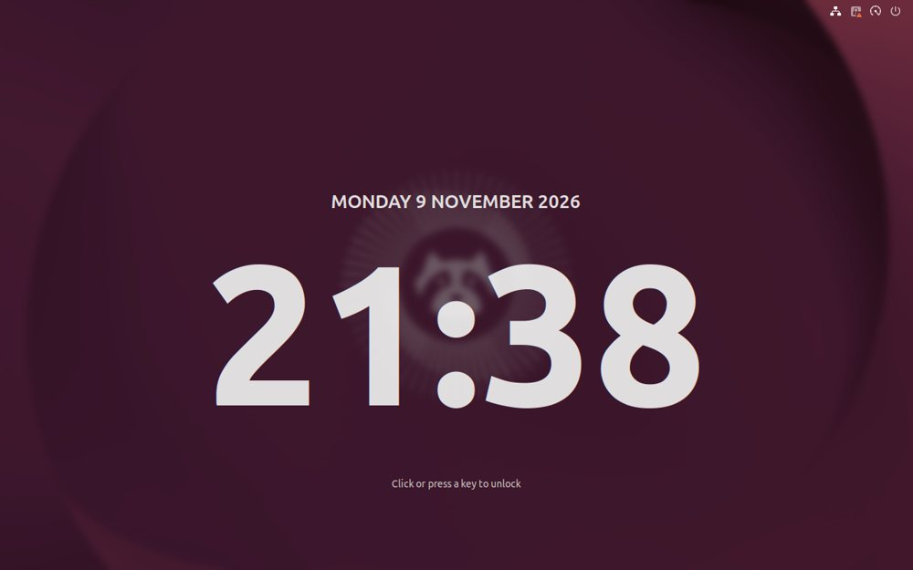
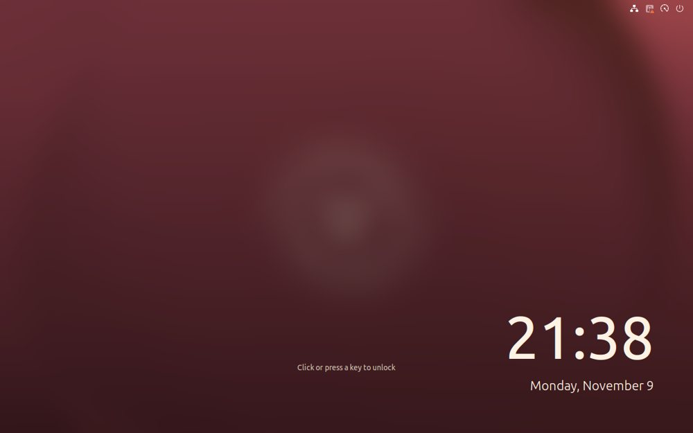
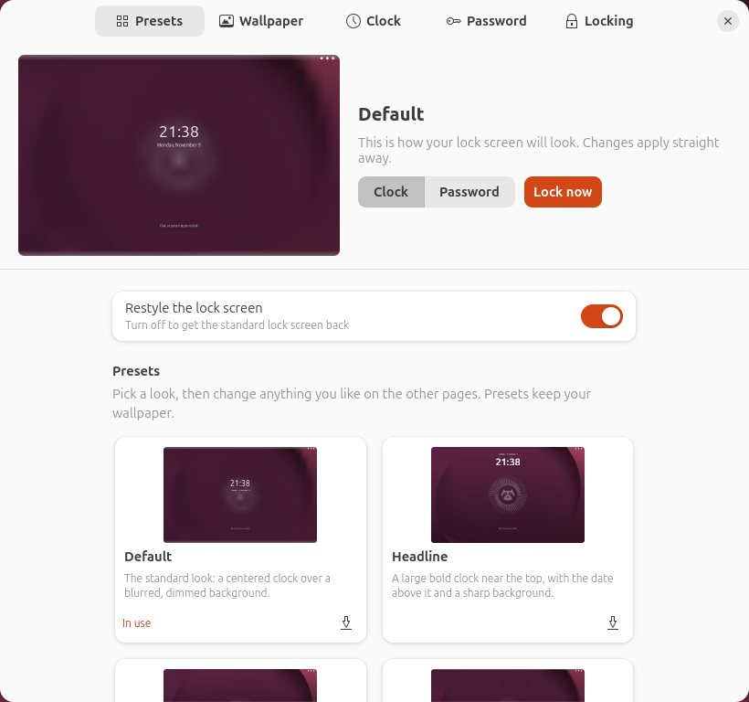
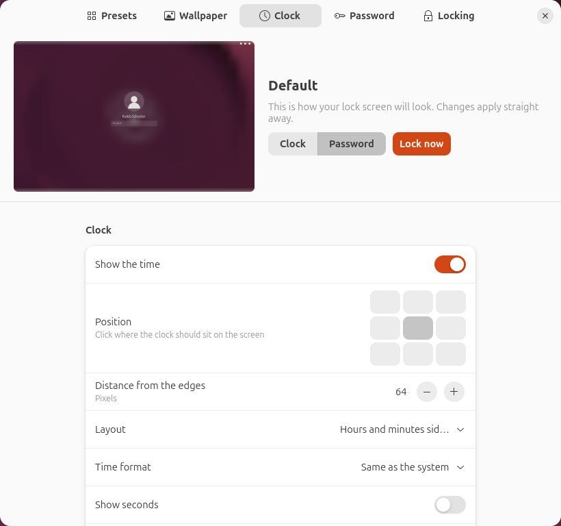

# Stoop

Restyle the GNOME lock screen. Give it its own wallpaper, move and resize the clock, change the date, the password prompt and more, or start from a ready-made preset. The settings window shows a live preview as you go.

## Screenshots

Presets, on the lock screen:

| Default | Headline | Stacked |
|---|---|---|
|  |  |  |
| **Terminal** | **Poster** | **Warm** |
|  |  |  |

The settings window, with its live preview always in view:

| Presets | Clock |
|---|---|
|  |  |

## Requirements

- GNOME Shell 50 (Ubuntu 26.04)
- A Wayland session, which is the Ubuntu default

Stoop has only been tested on Ubuntu 26.04 with GNOME Shell 50.1 on Wayland.

## Install

### With the deb package (recommended)

Download `stoop_1.0.0_all.deb` from the [latest release](https://github.com/webhookstudios/stoop/releases/latest), then install it:

```bash
sudo apt install ./stoop_1.0.0_all.deb
```

Log out and back in, then open **Stoop** from the apps menu. The first time, that turns it on and opens its settings.

To remove it:

```bash
sudo apt remove stoop
```

### As an extension zip, without root

```bash
wget https://github.com/webhookstudios/stoop/releases/latest/download/stoop@webhookstudios.github.io.shell-extension.zip
```

```bash
gnome-extensions install --force stoop@webhookstudios.github.io.shell-extension.zip
```

Log out and back in, then:

```bash
gnome-extensions enable stoop@webhookstudios.github.io
```

### From source

```bash
git clone https://github.com/webhookstudios/stoop.git
```

```bash
./stoop/install.sh
```

## Using it

Open **Stoop** from the apps menu, or run:

```bash
gnome-extensions prefs stoop@webhookstudios.github.io
```

The preview at the top stays in view on every page. Switch it between **Clock** and **Password** to see both states of the lock screen, and press **Lock now** to see the real thing.

| Page | What you can change |
|---|---|
| Presets | Nine built-in looks; save your own, and import or export them as files |
| Wallpaper | The desktop wallpaper, a picture of its own or a plain color; a gallery of your wallpaper folders; blur, brightness, tint, and darkening towards the bottom |
| Clock | Position (nine places), distance from the edges, side-by-side or stacked digits, 12 or 24 hour, seconds, size, weight, font, color, opacity, shadow; the date and its format; a line of your own text; the unlock hint |
| Password | Your picture and its size, your name, the password field's corners and colors, hiding the top bar |
| Locking | The system's own settings for blanking, automatic locking and notifications on the lock screen |

Changes apply straight away, also to a screen that is already locked. Presets change the look but keep your wallpaper and your text.

## Good to know

- Stoop changes the screen you see after locking. The sign-in screen shown when the computer starts belongs to the system and is not changed.
- Everything Stoop adds to the lock screen is display only. Unlocking works exactly as before, and turning the extension off brings the standard lock screen back.
- The blur in the preview is an approximation; the real one is smoother.

## Development

```bash
ln -s "$PWD/stoop@webhookstudios.github.io" ~/.local/share/gnome-shell/extensions/
```

```bash
glib-compile-schemas stoop@webhookstudios.github.io/schemas
```

A Wayland session cannot reload extension code, so each change needs a logout. To try changes without that, `test/headless.sh` starts a separate, invisible GNOME Shell with a throwaway home folder, locks it, applies every preset and saves screenshots.

Build the release files into `dist/` with `./pack.sh` (extension zip) and `./build-deb.sh` (deb package, needs only `dpkg-deb`).

| File | Purpose |
|---|---|
| `extension.js` | Finds the lock screen when it appears and restyles it |
| `css.js` | Builds the lock screen stylesheet from the settings |
| `model.js` | Settings helpers, time and date text, shared with the settings window |
| `presets.js` | The built-in presets |
| `prefs.js` | The settings window |
| `preview.js` | The drawing of the lock screen used for the preview |
| `wallpapers.js` | Finds pictures for the wallpaper gallery |

## License

GPL-2.0-or-later. See [LICENSE](LICENSE).
